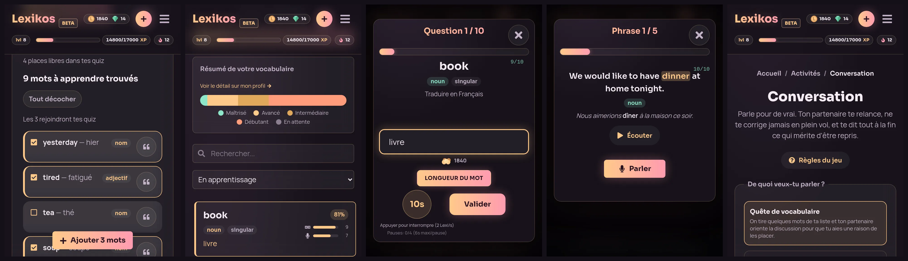
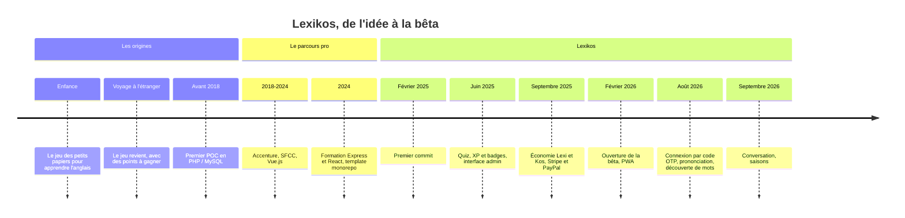
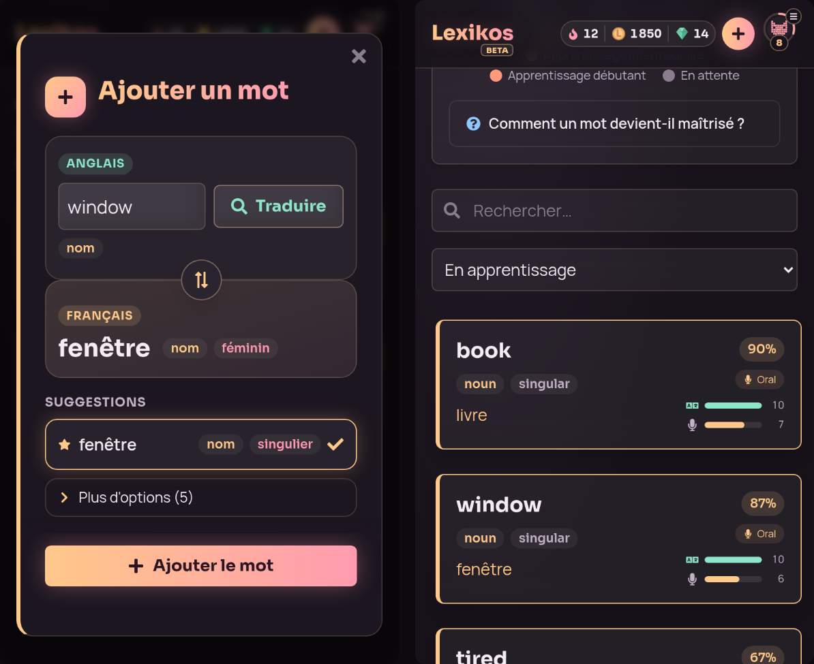
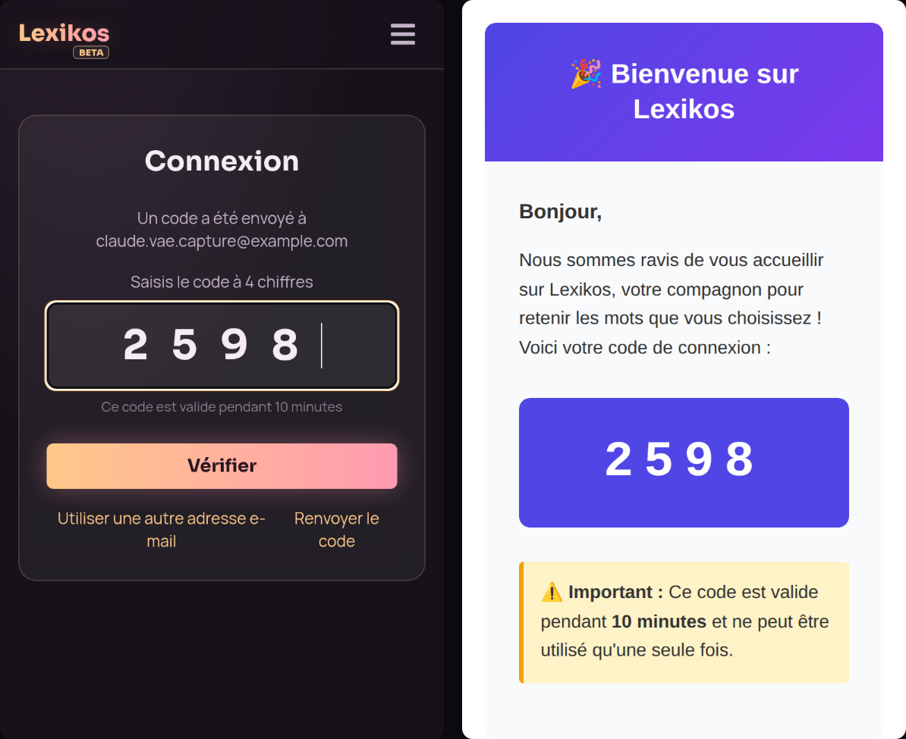
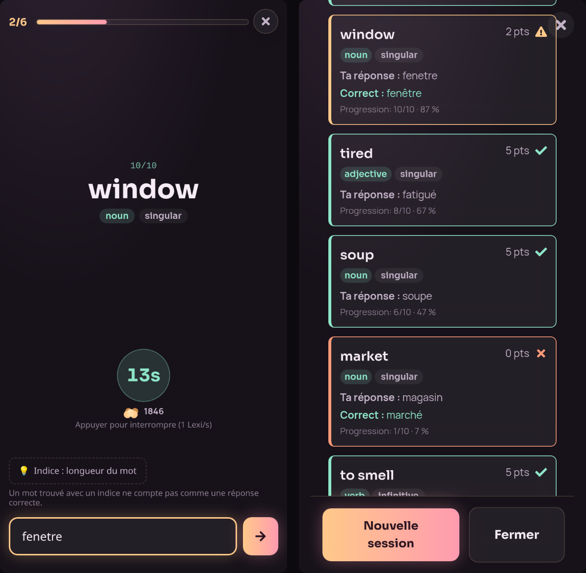
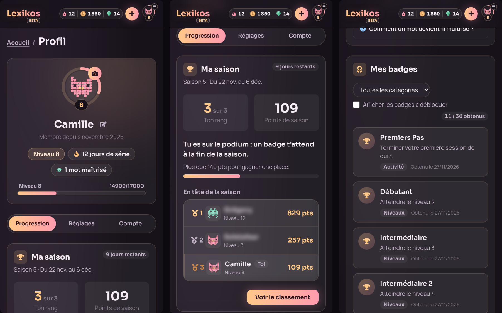
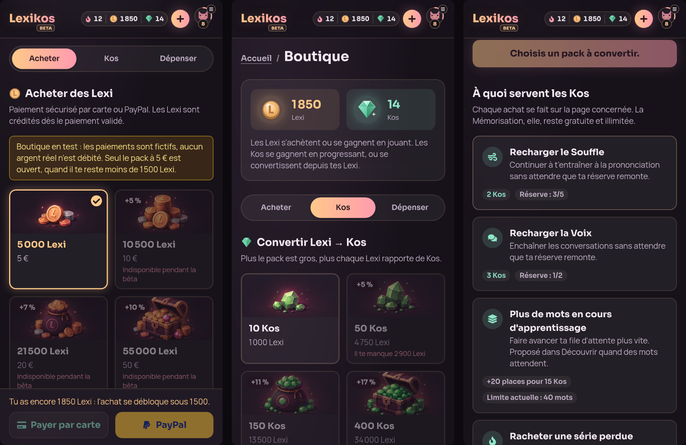
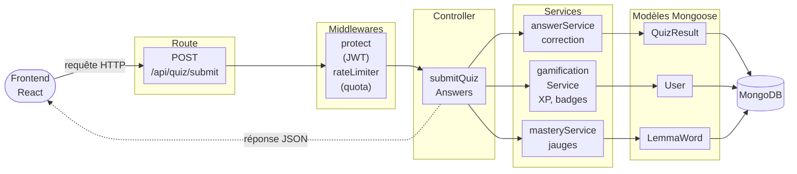
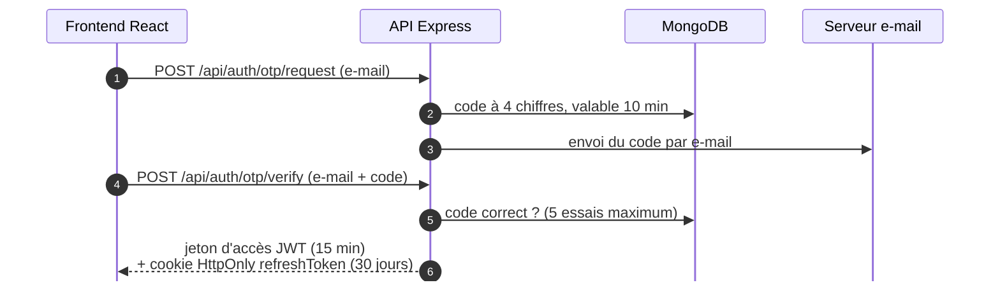
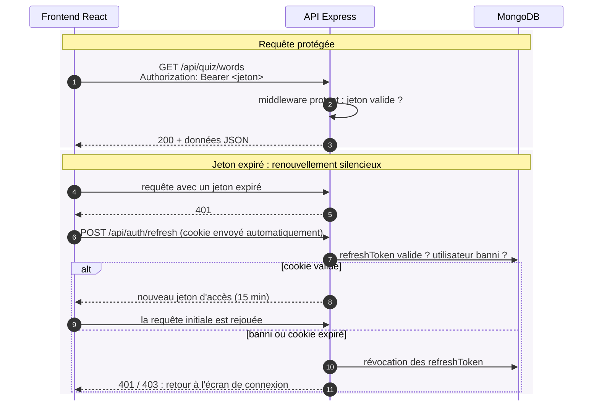

# Lexikos en quelques mots

Lexikos est une application web d'apprentissage du vocabulaire, que j'ai conçue et développée seul. L'utilisateur choisit les mots qu'il veut apprendre, par exemple ceux qu'il ne comprend pas devant une série en VO, et l'application les lui fait retenir grâce à des quiz, des exercices de prononciation et de conversation, le tout dans un esprit de jeu. Elle propose quatre langues (français, anglais, espagnol, allemand) et s'appuie sur son propre dictionnaire de 5,3 millions de mots.

Techniquement, c'est un frontend React et une API REST Express/Node.js avec une base MongoDB, déployés sur un VPS. Lexikos est en ligne sur **lexikos.eu**, en phase de bêta avec de vrais utilisateurs.

*De gauche à droite : découverte de mots, suivi du vocabulaire, quiz, prononciation, conversation.*

# Historique du projet

## L'origine : le jeu des petits papiers

Tout à commencé en jouant à un jeu très simple en étant enfant, lorsque je devais apprendre du vocabulaire en Anglais, je prenais des bouts de papiers avec écrit d'un côté le mot en Anglais, et de l'autre côté, sa traduction en Français. Tout les petits papiers étaient pliés puis mis dans un chapeau, ensuite, je les piochais un par un et essayait de retrouver la traduction du mot écrit. C'était plutôt efficace pour mémoriser le vocabulaire.  
Plus tard, après avoir bien avancé mon parcours dans l'informatique, et lors d'un voyage à l'étranger, cette façon d'apprendre du vocabulaire s'est présentée à nouveau à moi. Cette fois-ci, un mot retrouvé faisait gagner 1 point, et à la fin du jeu, on comptait les points, et le perdant payait sa tournée. C'est à ce moment là que je me suis dit qu'il y avait peut-être quelquechose à faire pour informatiser le concept.

## Un premier POC en PHP

En revenant de voyage, j'ai bricolé un POC sur l'idée, avec les technos que j'avais apprises à l'époque, c'est à dire un petit serveur local apache qui faisait tourner phpMyAdmin pour générer dynamiquement du HTML, avec imbriqué du Javascript et du CSS. les donnnées étaient persistées dans une bdd MySQL.  
A l'époque, je n'étais pas encore un développeur professionnel, et le projet n'a pas été plus loin. Et puis les applis d'apprentissage de langues sont sorties, et je suis dis que l'idée était déjà reprise et je suis passé à autre chose, comme devenir un vrai développeur, me faire embaucher par Accenture et bosser sur des projets d'envergure.

## Pourquoi relancer le projet

### Les applis existantes ne me conviennent pas

Bien plus tard, après avoir passé un peut de temps sur les apps d'apprentissage de langue, j'ai ressenti une insatisfaction sur ce qu'on me proposait. En effet j'estime que l'utilisateur devrait être maître des mots qu'il souhaite apprendre. 

### Mon besoin : les mots inconnus des séries en VO

Cela fait longtemps que je cherche à améliorer mon Anglais. J'aime beaucoup regarder des films et des séries en version originale car j'estime que c'est mieux d'entendre les vrai voix des acteurs. Je met les sous-titre en Anglais, mais pour les sourds et malentendants, de ce fait, le mot écrit apparait au même moment que le mot est prononcé. Je trouve que c'est très important pour se faire l'oreil à la langue. ça arrive très souvent qu'il y ait des mots que je ne comprends pas.  
Un mot pas compris, je fait pause, recherche le mot dans un dictionnaire, comprends le sens de la phrase et continue. C'est bien, mais le mot n'est pas du tout mémorisé, et l'apprentissage n'avance pas beaucoup.

### Mon bagage technique : Accenture, SFCC, Vue.js

Chez Accenture, j'ai développé essentiellement en JavaScript. J'ai été formé pour maîtriser Saleforce Commerce Cloud (plateforme ecommerce), tout le développement backend se fait en JavaScript. on utilisait node.js en local pour faire tourner l'environnement de développement.  
De base, SFCC est une solution monolithique, mais, il y a eu une évolution, des fonctionnalités headless ont été proposées par l'éditeur. j'ais donc appris à maîtriser le framework frontend Vue.js qui utilise JavaScript. J'ai été séduit par cette idée de séparer les responsabilités entre le backend et le frontend. 

### Le déclic

Cela faisiait un moment que je cherchais une idée de projet perso à réaliser.  Mes compétences de développeur ayant fait un énorme bon en avant gràce à mon expérience chez Accenture, j'ai décidé de me relancer sur le projet. Les apps existantes ne me conviennent pas, qu'à cela ne tienne, je créé la mienne.  
il y a eu plein de phases, d'évolutions, de mise à jour majeures, de nouvelles idées en cours de route. je me suis passionné pendant des mois à faire avancer le projet.

## De l'usage perso à une appli ouverte

Quand j'ai commencé, il y a eu une intense réflexion sur le projet.  
Initialement, je voulais juste informatiser le jeu avec les petits papiers, uniquement pour mon usage personnel. Puis, très vite je me suis dit que cela pourrait intéresser éventuellement d'autres personnes. ça impliquait mettre en place une interface, des regles, une persistance de data. J'ai donc commencé à réfléchir à la conception.

<!-- à rédiger : faisabilité : temps, coûts, risques (C27) -->

## Les choix techniques de départ

Avant de me lancer sur Lexikos, j'ai voulu rajouter des cordes à mon arc. je me suis formé sur Express, ainsi que sur REACT.js. ça faisait longtemps que je voulais acquérir ces compétences.  
J'ai ensuite créé un template 'hello world' de projet. Il s'agit d'un monorepo avec un front REACT et une API REST Express/Node.js. L'architecture client/serveur est donc découplée. Je suis parti de ça pour initialiser le projet.  
outillage posé dès le départ : ESLint, Prettier, Husky, Jest
Concernant la bdd, j'ai utilisé mongodb. Je n'avais pas encore d'expériences sur cette solution et je voulais essayer quelquechose de nouveau pour moi.  
j'ai utilisé dès le début git et un repo github, c'est, je trouve une des choses les plus importante à maîtriser dans le quotidien d'un développeur.

<!-- à rédiger : pourquoi mongo plutôt que du SQL (C12) -->

# Les fonctionnalités

## Le dictionnaire : l'utilisateur choisit ses mots

### Quatre langues dès le départ

J'ai dans mon entourage plusieurs personnes désireuses d'apprendre une langue étrangère. je voulais que dès le départ ma solution propose plusieurs langues. Mais je ne voulais en proposer trop d'un coup pour ne pas me surcharger. Je me suis dis que 4 langues suffiraient au départ. quitte à en rajouter plus tard. Les 4 langues de base sont le Français, l'Anglais, l'Espagnol, l'Allemand. L'idée c'est que ce soit utilisable dans n'importe quelle combinaison. Par exempe, un Allemand peut y apprendre l'Espagnol. L'interface est écrite dans la langue maternelle de l'utilisateur (la landing page s'affiche dans la langue du navigateur avec un fallback sur l'anglais, puis le user sélectionne sa langue maternelle lors de la création de son compte).  
avec les 4 langues combinées, il y 5,3 Million de mots racine qui sont liés à des variations (conjugaisons, divers formes grammaticales), ainsi qu'à des traductions. Le dictionnaire installé est donc très complet.  

<!-- capture à fournir : recherche d'un mot dans le dictionnaire et ajout à son vocabulaire -->

*Recherche d'un mot dans le dictionnaire et ajout à son vocabulaire.*

<!-- à rédiger : ajouter un mot à son vocabulaire -->
<!-- à rédiger : le système qui permet de générer des listes de mots en partant d'un sujet ou d'un livre libre de droits -->

## Se connecter sans mot de passe
<!-- compétences : C26 -->

Les users n'ont pas de password à retenir. un code OTP est envoyé à l'adresse mail à chaque fois qu'un user souhaite se connecter. J'ai mis ça en place après avoir parlé à des utilisateurs que ça rebute totalement de devoir mémoriser un password, et même, c'est une pratique qui est pour certains totalement rédhibitoire. Cela à été une surprise pour moi de constater, après le retour de plusieurs utilisateurs que la façon de s'authentifier ancestrale, donc avec le couple login/password, qui est considérée comme allant de sois par les gens qui baignent dans l'informatique, ne l'est pas pour d'autres. Mais voila, il ne faut pas hésiter à inover.

<!-- à rédiger : combien de users, comment j'ai eu leurs retours (C26) -->

<!-- capture à fournir : écran de saisie du code OTP (avec le mail reçu si possible) -->

*Connexion sans mot de passe : le code reçu par e-mail.*

## Les activités

### activité de mémorisatinon.

Le choix des mots : les mots à réviser passent en priorité. Les mots déjà maîtrisés ne reviennent que pour un contrôle de temps en temps.  
La correction : les petites fautes de frappe sont tolérées. une réponse juste fait monter la jauge 'écrit' du mot (de 0 à 10), une réponse fausse la fait baisser.

<!-- capture à fournir : une question de quiz avec sa correction -->

*Une question du quiz de mémorisation et sa correction.*

### activité de prononciation.

Le choix des mots : en priorité les mots dont la jauge 'oral' est la plus basse. En mode phrase, de courtes phrases contenant le mot sont proposées.  
L'écoute : une voix lit le mot ou la phrase pour donner le modèle à imiter.  
La correction : l'élève s'enregistre, et sa prononciation est comparée au mot attendu, avec la même tolérance que pour le quiz. Une prononciation juste fait monter la jauge 'oral' du mot (de 0 à 10).  
Chaque session consomme du Souffle, une réserve d'énergie qui se recharge avec le temps, car les appels aux modèles ont un coût.

<!-- capture à fournir : enregistrement de la prononciation et résultat, jauge 'oral' -->

*L'élève s'enregistre, sa prononciation est comparée au mot attendu.*

### activité de conversation.

<!-- à rédiger : la conversation -->

<!-- capture à fournir : un échange de conversation en cours -->

*Un échange en cours dans l'activité de conversation.*

## La gamification

XP et niveaux : monter de niveau débloque des fonctionnalités.  
Série (streak) : on enchaîne les jours d'activité. Une série cassée peut être rachetée, avec des limites.  
Badges : ils sont attribués selon des seuils (nombre de quiz, mots maîtrisés…).
Saisons : un classement remis à zéro toutes les 2 semaines.

<!-- capture à fournir : profil avec XP/niveau, série, badges, classement de saison -->

*Niveau, série, badges et classement de la saison.*

## L'économie

Les Lexi se gagnent en jouant, avec un plafond par jour. Il est également possible de les acheter avec des Euros. Kos est la monnaie premium, achetée ou obtenue en convertissant des Lexi.  

Je ne fait payer ce qui coûte et rien d'autre :  
L'activité de mémorisation est gratuite et illimitée car elle ne coute rien à faire tourner (à part quelques ressources de serveur).  
La prononciation et la conversation consomment de l'énergie, parce que chaque tour appelle un modèle payant.  
Il y a deux réserves d'énergie séparées, le Souffle et la Voix car une conversation coûte environ dix fois plus cher qu'une prononciation.  
les deux réserves d'énergie se renouvellent toutes seules avec le temps, mais il est possible d'accélérer la régénération en dépensant des Kos.  

<!-- à rédiger : la boutique -->

<!-- capture à fournir : boutique Lexi/Kos et réserves d'énergie Souffle/Voix -->

*La boutique : packs de Lexi et de Kos, réserves de Souffle et de Voix.*

Actuellement, la phase beta est en cours, les achats dans la boutique se font sur des comptes stripe et paypal de test. Lorsque la beta sera terminée, les véritables moyens de paiements seront ouverts et toutes les sommes achetées lors de la beta seront remises à 0 via un job. Les testeurs de la phase beta recevront un badge de pionnier qui leur permettra de générer quelques Lexi / semaine gratuitement en remerciements de leur aide apportée.  
Equilibrer une économie de jeu est difficile. Il faut que gagner soit motivant sans que ça impacte les ventes.  

anecdote de comportement d'utilisateur :  
J'avais mis dès le départ le bouton pour les pionniers pour générer des Lexi. il y avait une limite quotidienne d'une certaine somme. Certains utilisateurs allaient dans le jeu pour cliquer sur le bouton pour générer des Lexi. Et après ça, ils ne le dépensaient pas, ils utilisaient juste les fonctionnalités gratuites. Moi, je pensais que les joueurs n'allaient utiliser le bouton de génération que parcequ'ils avaient besoin de faire des achats dans le jeu (plus d'activité de prononciation par exemple), et bien non. Donc ils se sont retrouvé avec des sommes importantes de Lexi non dépensées, ça faussait complétement les statistiques autour de l'économie. En voyant ça, j'ai désactivé la fonctionnalité, ça à entrainé lors arret total de fréquentation. Amusant pour des testeurs.

<!-- à rédiger : ce que montraient les stats, ce que j'en ai tiré (C26, C31) -->
<!-- à rédiger : Souffle et Voix : décidé à partir des coûts (C31) -->

# Le backend

## l'architecture
<!-- compétences : C8, C19 -->

L'API REST Express est découpée en routes, controllers, services, modèles.  
Les routes définissent tous les endpoints de l'API, elles permettent de lier une URL à un controller. Elles indiquent aussi quels contrôles passer avant le controller (les middlewares) : être connecté, ne pas dépasser le nombre de requêtes autorisées.  
Les controllers coordonnent. Un controller lit la requête HTTP, appelle les bons services, puis renvoie une réponse en JSON.  
C'est dans les services que sont écrites les règles métier (calculs, décisions). Par exemple, le service answerService.js, dont le rôle est de vérifier si une réponse de quiz est correcte.  
Les modèles décrivent les collections de MongoDB, c'est aussi là que sont écrites les fonctions d'interaction avec la base de données (lecture, écriture).

*Le trajet d'une requête dans l'API, avec l'exemple de la soumission d'un quiz.*

<!-- à rédiger : pourquoi ces couches (C8) -->
<!-- à rédiger : POO, design patterns (C8) -->
<!-- à rédiger : monolithe ou microservices (C19) -->

## Le dictionnaire
<!-- compétences : C11, C27 -->

### Premiers POC : l'utilisateur saisit ses mots

j'ai fait des POC. Puisque le USER est maitre des mots qu'il souhaite d'apprendre (c'est vraiment le plus important pour moi), au début, le user saisissait ses couples de mots langue cible/langue maternelle, le couple était associé dans la base, mais c'était donner beaucoup trop de confiance au user sur sa capacité à ne pas faire d'erreurs de saisie ou de traduction. ce qui ne tiens pas debout car la source d'erreurs de saisies et d'erreurs suite à des incompréhensions humaines est majorée. Je me suis donc dis qu'il fallait mettre en place un controle sur les traductions, mais aussi un dictionnaire.

J'ai aussi exploré l'idée de constituer le dictionnaire petit à petit, au fil des recherches des utilisateurs, donc de connecter l'appli à une API qui retourne la traduction par rapport au mot saisi, et que le retour soit enregistré dans la bdd.  
j'ai essayé plusieurs fournisseurs de traduction proposant une entrée API. Certains étaient bien trop chères, d'autres peu précis. J'ai même envisagé serieusement de brancher une API de LLM mais les réponses n'étaient pas toujours cohérentes.  
C'était donner trop de confiance dans le retour de l'API, le temps de réponse était trop long, il aurait fallut des années pour constituer une bdd solide, et le cout d'appels API faisait exploser les couts sur le long terme.

Tout cela m'a permis de comprendre que j'avais besoin pour chaque mot saisi par le user, de savoir son PartOfSpeech (partie grammaticale, pluriel/singulier, verbe à l'infinitif/conjugué... ), ainsi que les traductions possibles.

### La solution : importer Wiktionary

A force de tester divers solutions, c'est devenu clair qu'il fallait que mon appli utilise son propre dictionnaire, présent dans la bdd, donc, requétable très rapidement. J'ai recherché les solutions openSource et ait trouvé la solution wiktionnary (licence CC BY-SA 4.0). J'ai créé un script d'importation qui télécharge les dumps dans les langues souhaitées, les parcourt entièrement et en extrait uniquement les données souhaitées pour les besoins du projet.
wiktionnary m'a permis d'importer lemmes, variantes, partOfSpeech, catégories. Le script est optimisé pendant des semaines (points de reprise, journaux, insertions par lots).

Le dictionnaire ainsi que la stack technique étant en place, j'avais des bases solides pour continuer à avancer sur le projet. 

<!-- à rédiger : les chiffres de l'import (C11) -->
<!-- à rédiger : les index (C11) -->

## L'authentification
<!-- compétences : C15 -->

L'authentification repose sur deux mécanismes : un code à usage unique (OTP) envoyé par e-mail pour se connecter, puis des jetons JWT pour rester connecté.

### La connexion par code OTP

Un nouvel utilisateur et un utilisateur déjà inscrit utilisent le même formulaire de connexion. Ils saisissent leur adresse e-mail, un code OTP à 4 chiffres est généré et leur est envoyé par e-mail. L'utilisateur a alors 10 minutes pour saisir ce code dans la deuxième partie du formulaire, avec 5 essais au maximum. Si le code est bon, l'utilisateur est connecté.  
Cette façon de faire permet de se passer de mot de passe, et elle permet aussi de vérifier que l'adresse e-mail est correcte : recevoir le code prouve que l'adresse existe et appartient bien à l'utilisateur.  
Un nouvel utilisateur qui ne saisit pas le code dans le temps imparti voit son compte supprimé automatiquement, grâce à un index TTL de MongoDB qui efface le document à l'expiration du code.

### Les jetons JWT

Une fois le code validé, l'API génère deux jetons :

- un jeton d'accès JWT, d'une durée de vie de 15 minutes. Le frontend l'ajoute à chaque requête envoyée vers une route protégée, et le middleware d'authentification `protect` le vérifie ;
- un jeton de renouvellement (refresh token), d'une durée de vie de 30 jours, stocké dans un cookie HttpOnly, donc inaccessible au JavaScript de la page.

*La connexion : le code reçu par e-mail est échangé contre les deux jetons.*

### Le renouvellement et le bannissement

Quand le jeton de 15 minutes a expiré, l'API répond par une erreur 401. Le frontend appelle alors la route de renouvellement : le cookie de 30 jours est contrôlé, et s'il est valide, un nouveau jeton de 15 minutes est généré. La requête initiale est ensuite rejouée, sans que l'utilisateur s'en aperçoive.  
Le cookie de 30 jours, lui, n'est pas renouvelé : il garde sa date d'expiration d'origine. L'utilisateur reste donc connecté sans rien faire pendant 30 jours, puis doit se reconnecter avec un nouveau code.  
Un utilisateur banni voit ses jetons de renouvellement révoqués et ne peut plus obtenir de nouveau jeton d'accès : il est renvoyé à l'écran de connexion.

*Une requête protégée, puis le renouvellement du jeton d'accès quand il a expiré.*

<!-- à rédiger : rate limit, helmet, bannissement (C15) -->
<!-- à rédiger : protection des routes admin (C15) -->
<!-- à rédiger : le jeton en localStorage et le XSS (C15) -->
<!-- à rédiger : l'OTP en Math.random, à corriger (C15) -->

## Les activités côté serveur

### mémorisation

Le serveur pioche dans le vocabulaire de l'élève et fait passer en priorité les mots à réviser. Le serveur tolère les petites fautes de frappe.

<!-- à rédiger : comment les mots à réviser sont choisis, comment la tolérance aux fautes de frappe est calculée -->

### prononciation

Le serveur pioche dans le vocabulaire de l'élève, en priorité les mots dont la jauge 'oral' est la plus basse. En mode phrase, un LLM génère de courtes phrases contenant le mot, et le serveur vérifie que le mot y figure bien avant de les proposer.  
Un modèle de synthèse vocale lit le mot ou la phrase.  
Un modèle de transcription convertit l'audio de l'élève en texte, puis le serveur compare ce texte au mot attendu.

<!-- à rédiger : la prononciation : un modèle qui génère des phrases, un modèle qui génère une voix pour dire la phrase, un modèle qui analyse si la prononciation est correcte -->
<!-- à rédiger : mise en place d'un cache pour sauvegarder les phrases générées afin de les réutiliser -->

### conversation

<!-- à rédiger : la conversation côté serveur -->

## Paiements et suivi des coûts
<!-- compétences : C31 -->

2 moyens de paiements sont implémentés, Stripe et Paypal. les factures PDF numérotées sont générées. Le coût de chaque appel à un modèle est enregistré, pour savoir combien coûte un utilisateur.les prix, plafonds et packs de lexi et de Kos se modifient depuis l'admin, sans redéployer.  

<!-- à rédiger : la sécurité des webhooks de paiement (C15) -->
<!-- à rédiger : le calcul du coût d'un appel (C31) -->

## Hébergement et exploitation

<!-- à rédiger : la mise en place du projet sur un VPS -->
<!-- à rédiger : pourquoi un VPS (C18) -->
<!-- à rédiger : nginx et pm2 (C9) -->
<!-- à rédiger : docker et podman (C23) -->
<!-- à rédiger : ci/cd (C25) -->
<!-- à rédiger : les logs, la supervision (C20) -->
<!-- à rédiger : la sauvegarde de la base de données sur un hébergeur indépendant (C13) -->
<!-- à rédiger : l'incident des sauvegardes de septembre (C13) -->
<!-- à rédiger : le test de restauration (C13) -->
<!-- à rédiger : l'interface admin!!!! -->

## La conception de l'API

<!-- à rédiger : les conventions REST (C14) -->
<!-- à rédiger : swagger (C17) -->

## Les tests

<!-- à rédiger : les tests d'intégration (C16, C34) -->
<!-- à rédiger : les tests de charge k6 (C16) -->
<!-- à rédiger : quand les tests tournent (C34) -->

# Le frontend

<!-- à rédiger : expliquer le frontend, en s'appuyant sur ../historique_frontend.md (React/Vite, refonte Lumen, i18n, PWA, SEO, responsive) -->
<!-- à rédiger : accessibilité, SEO (C1) -->
<!-- à rédiger : tailwind, responsive (C2, C3) -->
<!-- à rédiger : axios, renouvellement du jeton, socket.io (C4, C5) -->
<!-- à rédiger : Context, PWA, i18n (C6) -->
<!-- à rédiger : la page profil -->
<!-- à rédiger : les pages légales -->

# Méthode de travail

## L'environnement de développement

<!-- à rédiger : mon environnement de dev (C7) -->

## La conduite du projet

<!-- à rédiger : comment j'ai organisé le projet seul (C29) -->

## Git et les pull requests

<!-- à rédiger : branches et PR (C21, C22) -->

## Qualité du code et documentation

<!-- à rédiger : eslint, prettier, husky (C33) -->
<!-- à rédiger : la doc du projet (C35) -->

